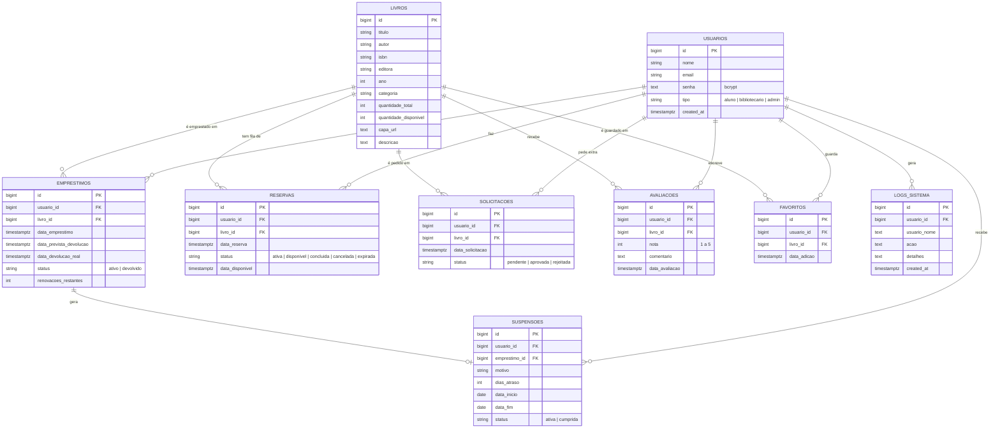

# Banco de dados

PostgreSQL hospedado no Supabase. As regras ficam em funções SQL no próprio banco (lista em [FUNCOES-SUPABASE.md](FUNCOES-SUPABASE.md)), e as tabelas novas da versão 2 são criadas por [`supabase/migracao-v2.sql`](../supabase/migracao-v2.sql).

## Diagrama entidade-relacionamento

O GitHub desenha o diagrama abaixo automaticamente. Para colocar nos slides, use a imagem [diagrama-er.png](diagrama-er.png).

## Decisões de modelagem

**Regras no banco, não no navegador.** Limite de empréstimos, prazos, suspensão e fila de reserva estão em funções SQL. Assim, ninguém burla uma regra mexendo no JavaScript da página, e o site pode ser só arquivos estáticos no GitHub Pages.

**RLS ligado em todas as tabelas.** O navegador só consegue ler a tabela `livros` direto. Todo o resto passa pelas funções, que conferem o perfil de quem pede (`eh_bibliotecario`, `eh_admin`).

**Senhas com bcrypt.** O cadastro guarda a senha com `crypt(senha, gen_salt('bf'))`, da extensão pgcrypto, e o login compara com `crypt(senha_digitada, senha_guardada)`. A senha original nunca fica salva.

**Estoque no próprio livro.** Em vez de uma tabela de exemplares, `livros` guarda `quantidade_total` e `quantidade_disponivel`. Para uma biblioteca escolar isso basta e simplifica as consultas. Cada função roda numa transação só, então o empréstimo e a baixa no estoque acontecem juntos ou não acontecem.

**Histórico preservado.** Reservas e solicitações nunca são apagadas, só mudam de status (`cancelada`, `concluida`, `expirada`, `rejeitada`). As ações importantes ficam registradas em `logs_sistema`.

**Uma avaliação por aluno em cada livro.** Garantido no banco com `UNIQUE (usuario_id, livro_id)`. Se o aluno avaliar de novo, a nota é atualizada (`on conflict do update`).

**Apagar em cascata só onde faz sentido.** Avaliações e favoritos somem junto com o livro ou o usuário (`on delete cascade`). Empréstimos e reservas não, então o banco impede excluir quem tem histórico.

**Datas no fuso de Brasília.** O servidor do Supabase roda em UTC. As funções novas usam `libro_hoje()`, senão um livro "atrasaria" às 21h do último dia.
