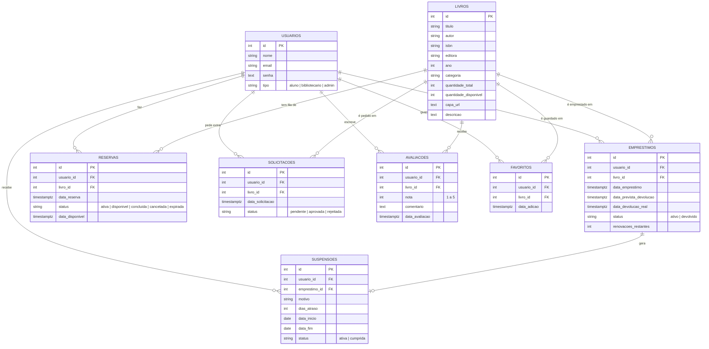

# Banco de dados

PostgreSQL hospedado no Supabase. As tabelas são criadas pelo Sequelize ao iniciar o servidor (`sequelize.sync()`), e o arquivo [`schema.sql`](../schema.sql) traz o mesmo modelo em SQL puro.

## Diagrama entidade-relacionamento

O GitHub desenha o diagrama abaixo automaticamente. Para colocar nos slides, use a imagem [diagrama-er.png](diagrama-er.png).

## Decisões de modelagem

**Estoque no próprio livro.** Em vez de uma tabela de exemplares, `livros` guarda `quantidade_total` e `quantidade_disponivel`. Para uma biblioteca escolar isso basta e simplifica muito as consultas. Para não haver erro de contagem, toda operação que mexe no estoque (empréstimo, devolução, aprovação de solicitação) roda dentro de uma **transação com trava na linha do livro** (`SELECT ... FOR UPDATE`).

**Status como texto.** O projeto começou em MySQL com `ENUM`. Na migração para PostgreSQL, os campos viraram `VARCHAR` com validação no model do Sequelize (`isIn`), o que é mais simples de alterar depois.

**Histórico preservado.** Reservas e solicitações nunca são apagadas: mudam de status (`cancelada`, `concluida`, `expirada`, `rejeitada`). Assim dá para gerar relatórios do passado.

**Uma avaliação por aluno em cada livro.** Garantido no banco com `UNIQUE (usuario_id, livro_id)`. Se o aluno avaliar de novo, a nota antiga é atualizada.

**Apagar em cascata só onde faz sentido.** Avaliações e favoritos são apagados junto com o livro ou o usuário (`ON DELETE CASCADE`). Empréstimos não: o sistema impede excluir livro ou usuário com empréstimo ativo.

**Datas no fuso de Brasília.** O servidor roda em UTC. As comparações de prazo usam a data no fuso `America/Sao_Paulo` (ver `utils/datas.js`), senão um livro "atrasava" às 21h do último dia.
